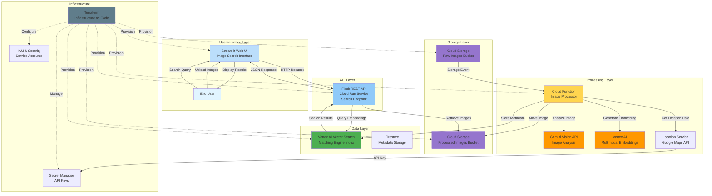

# Image Search with Gemini

A comprehensive, cloud-native image search solution powered by Google Cloud's Gemini AI, Vertex AI Matching Engine, and modern web technologies. This system enables intelligent image processing, semantic understanding, and similarity-based search capabilities using state-of-the-art multimodal AI models.

## 🏗️ Architecture



## 📋 Project Overview

This project implements an end-to-end image search pipeline that:

1. **Automatically processes** uploaded images using Gemini's vision capabilities
2. **Generates semantic embeddings** from both visual content and AI-generated descriptions
3. **Stores embeddings** in a high-performance vector database for similarity search
4. **Provides a modern web interface** for searching images using natural language queries
5. **Enriches metadata** with location information using Google Maps API

### Key Features

- 🤖 **AI-Powered Analysis**: Gemini Vision API analyzes images for context, objects, and visual characteristics
- 🔍 **Semantic Search**: Find images using natural language descriptions, not just keywords
- 📍 **Location Intelligence**: Automatic location enrichment using Google Maps API
- ⚡ **Event-Driven**: Serverless architecture with Cloud Functions for automatic processing
- 🎨 **Modern UI**: Streamlit-based interface with Material Design styling
- 🔧 **Infrastructure as Code**: Complete Terraform configuration for reproducible deployments
- 📊 **Vector Search**: High-performance similarity search using Vertex AI Matching Engine

## 🔄 Data Flow

### Image Upload and Processing

1. **Upload**: User uploads an image to the Cloud Storage raw bucket
2. **Trigger**: Storage event triggers the Cloud Function
3. **Download**: Function downloads the image from storage
4. **Location Extraction**: Extracts location from image metadata or file path
5. **Location Enrichment**: Queries Google Maps API for detailed location information
6. **AI Analysis**: Gemini analyzes the image, generating:
   - Context description
   - Visual characteristics
   - Object annotations
7. **Embedding Generation**: Creates a 1408-dimension multimodal embedding combining:
   - Visual features from the image
   - Textual context from Gemini's analysis
8. **Vector Storage**: Stores embedding and metadata in Vector Search index
9. **Archival**: Moves processed image to the processed bucket

### Image Search

1. **Query Input**: User enters a natural language search query
2. **Text Embedding**: Search API generates an embedding from the query text
3. **Vector Search**: Queries the Vector Search index for nearest neighbors
4. **Results Ranking**: Results sorted by similarity score
5. **Display**: UI fetches and displays matching images with metadata

## 🏛️ System Components

### 1. Image Processor (Cloud Function)

**Location**: `src/image_processor/`

A serverless Cloud Function that processes uploaded images:

- **Trigger**: Cloud Storage object finalization event
- **Input**: Raw images from upload bucket
- **Components**:
  - `main.py`: Event handler and orchestration logic
  - `analyzer.py`: Gemini image analysis integration
  - `embedding.py`: Multimodal embedding generation
  - `vector_store.py`: Vector Search client
  - `location_service.py`: Google Maps API integration
- **Output**: Embeddings stored in Vector Search, images moved to processed bucket

### 2. Search API (Flask on Cloud Run)

**Location**: `src/search_api/`

RESTful API service for querying images:

- **Endpoints**:
  - `POST /search`: Text-based image search
  - `GET /health`: Health check endpoint
- **Features**:
  - Text query to embedding conversion
  - Configurable similarity thresholds
  - Adjustable result count
  - Metadata enrichment
- **Deployment**: Containerized service on Cloud Run

### 3. Web UI (Streamlit on Cloud Run)

**Location**: `src/ui_search/`

Modern, responsive web interface:

- **Features**:
  - Natural language search input
  - Grid-based results display
  - Similarity score visualization (raw + normalized)
  - Expandable metadata details
  - Sorting options (similarity, date, name)
  - Mock data mode for testing
  - Configurable result limits
- **Design**: Material Design-inspired styling
- **Authentication**: Integrated with Google Cloud IAM
- **Image Access**: Signed URL generation for private bucket access

### 4. Infrastructure (Terraform)

**Location**: `terraform/`

Complete infrastructure as code:

- **Modules**:
  - `api_service`: Search API Cloud Run deployment
  - `functions`: Cloud Function deployment
  - `iam`: Service accounts and permissions
  - `policy`: Organization policies
  - `storage`: Cloud Storage buckets
  - `ui`: Streamlit UI Cloud Run deployment
  - `vector_search`: Vertex AI index and endpoint

## 🛠️ Technology Stack

### Cloud Services

| Service | Purpose |
|---------|---------|
| **Cloud Storage** | Stores raw and processed images |
| **Cloud Functions** | Serverless image processing |
| **Cloud Run** | Hosts API and UI containers |
| **Vertex AI Gemini** | Image analysis and understanding |
| **Vertex AI Embeddings** | Multimodal embedding generation (1408 dimensions) |
| **Vertex AI Matching Engine** | Vector similarity search |
| **Eventarc** | Event routing from Storage to Functions |
| **Secret Manager** | Secure API key storage |
| **Firestore** | Metadata and configuration storage |
| **Google Maps API** | Location data enrichment |
| **Artifact Registry** | Container image storage |
| **Cloud Build** | Container image building |

### Development Tools

- **Python 3.x**: Primary programming language
- **Terraform**: Infrastructure provisioning
- **Docker**: Containerization
- **Streamlit**: UI framework
- **Flask**: API framework

## 📦 Installation and Deployment

### Prerequisites

1. **GCP Project**: Create a GCP project and note the ID and number
2. **Billing**: Enable billing on your project
3. **Tools**:
   - [gcloud CLI](https://cloud.google.com/sdk/docs/install)
   - [Terraform](https://www.terraform.io/downloads) >= 1.0
   - [Docker](https://docs.docker.com/get-docker/)
   - [Git](https://git-scm.com/downloads)

### Environment Setup

```bash
# 1. Clone the repository
git clone https://github.com/your-username/image-search.git
cd image-search

# 2. Set environment variables
export GOOGLE_PROJECT=<your-project-id>
export GOOGLE_REGION=<your-region>  # e.g., us-central1
export GOOGLE_PROJECT_NUMBER=<your-project-number>

# 3. Authenticate with GCP
gcloud auth login
gcloud auth application-default login
gcloud config set project $GOOGLE_PROJECT
```

### Deploy Infrastructure

```bash
# Navigate to Terraform directory
cd terraform

# Initialize Terraform
terraform init

# Review the deployment plan
terraform plan \
  -var="project_id=$GOOGLE_PROJECT" \
  -var="project_number=$GOOGLE_PROJECT_NUMBER" \
  -var="region=$GOOGLE_REGION"

# Deploy infrastructure
terraform apply \
  -var="project_id=$GOOGLE_PROJECT" \
  -var="project_number=$GOOGLE_PROJECT_NUMBER" \
  -var="region=$GOOGLE_REGION"
```

### Post-Deployment

After successful deployment, Terraform outputs:

- **Raw Bucket**: Upload images here for processing
- **Processed Bucket**: Stores processed images
- **API Endpoint**: Search API URL
- **UI Endpoint**: Web interface URL
- **Vector Search Index**: Index ID for direct API access

## 🔐 Security and IAM

### Service Account Permissions

The Cloud Function and Cloud Run services use a service account with these roles:

| Role | Purpose |
|------|---------|
| `roles/aiplatform.user` | Access Vertex AI services |
| `roles/storage.objectAdmin` | Read/write Cloud Storage objects |
| `roles/secretmanager.secretAccessor` | Access API keys from Secret Manager |
| `roles/run.invoker` | Invoke Cloud Run services |
| `roles/eventarc.eventReceiver` | Receive storage events |
| `roles/logging.logWriter` | Write logs |
| `roles/cloudfunctions.developer` | Deploy Cloud Functions |
| `roles/artifactregistry.reader` | Pull container images |

### API Key Security

- Google Maps API keys stored in Secret Manager
- Automatic key rotation support
- Least-privilege access controls
- API restrictions configured per service

## 🧪 Testing

### Upload Test Images

```bash
# Upload an image for processing
gsutil cp /path/to/image.jpg gs://${GOOGLE_PROJECT}-raw-images/

# Upload with location metadata
gsutil -h "x-goog-meta-location:Paris" cp image.jpg gs://${GOOGLE_PROJECT}-raw-images/
```

### Using Mock Data

The UI includes a mock data mode for testing without deploying the full infrastructure:

1. Open the web UI
2. Toggle "Use mock data" in the sidebar
3. Search with any query to see sample results

### Example Scripts

**Location**: `example/`

- `upload.py`: Script for uploading images with metadata
- `image-dld.py`: Batch image download utility
- `mock_upload_test.py`: Test image upload functionality

## 🔍 Usage Examples

### Search Queries

The system understands natural language queries:

- "Modern skyscrapers in downtown areas"
- "Sunset at the beach with palm trees"
- "Coffee shop workspace with laptop"
- "Mountain landscapes with snow"
- "Food photography with fresh vegetables"

### API Usage

```python
import requests

# Search for images
response = requests.post(
    'https://your-api-endpoint/search',
    json={
        'query': 'sunset at the beach',
        'num_results': 10,
        'threshold': 0.5
    }
)

results = response.json()
for result in results['results']:
    print(f"Image: {result['id']}")
    print(f"Similarity: {result['similarity_score']}")
    print(f"Context: {result['metadata']['context']}")
```

## 📊 Monitoring and Logging

### Cloud Logging

All components write structured logs to Cloud Logging:

```bash
# View Cloud Function logs
gcloud functions logs read process_image --limit 50

# View API logs
gcloud logging read "resource.type=cloud_run_revision" --limit 50
```

### Metrics

Key metrics to monitor:

- Image processing latency
- Embedding generation time
- Vector search query performance
- API response times
- Error rates and types

## 🚀 Performance Optimization

### Current Implementation

- **Embedding Dimensions**: 1408 (Vertex AI multimodal model)
- **Vector Search**: Approximate nearest neighbor (ANN)
- **Indexing**: Tree-AH algorithm for fast retrieval
- **Caching**: Signed URL generation for reduced API calls

### Recommendations

- Implement image preprocessing for size optimization
- Add caching layer for frequently accessed images
- Enable batch processing for bulk uploads
- Configure auto-scaling for Cloud Run services

## 🗺️ Roadmap

### Completed ✅

- Core image processing pipeline
- Gemini integration for image analysis
- Vector embeddings and search
- REST API implementation
- Web UI with Material Design
- Location enrichment
- Terraform infrastructure

### Planned 🚧

- User authentication and multi-tenancy
- Image collections and albums
- Advanced filtering options
- Image-to-image search
- Batch upload interface
- Mobile app
- Analytics dashboard
- Export functionality

## 🐛 Troubleshooting

### Common Issues

**Images not processing**
- Check Cloud Function logs for errors
- Verify service account permissions
- Ensure image format is supported (JPEG, PNG)

**Search returns no results**
- Verify Vector Search index is deployed
- Check API endpoint configuration in UI
- Review similarity threshold settings

**UI cannot display images**
- Verify signed URL generation
- Check bucket permissions
- Ensure service account has storage access

## 📚 Additional Resources

- [Vertex AI Documentation](https://cloud.google.com/vertex-ai/docs)
- [Gemini API Guide](https://cloud.google.com/vertex-ai/docs/generative-ai/model-reference/gemini)
- [Vector Search Documentation](https://cloud.google.com/vertex-ai/docs/matching-engine/overview)
- [Cloud Functions Documentation](https://cloud.google.com/functions/docs)
- [Terraform Google Provider](https://registry.terraform.io/providers/hashicorp/google/latest/docs)

## 📄 License

Copyright 2024 Google LLC

Licensed under the Apache License, Version 2.0 (the "License");
you may not use this file except in compliance with the License.
You may obtain a copy of the License at

    https://www.apache.org/licenses/LICENSE-2.0

Unless required by applicable law or agreed to in writing, software
distributed under the License is distributed on an "AS IS" BASIS,
WITHOUT WARRANTIES OR CONDITIONS OF ANY KIND, either express or implied.
See the License for the specific language governing permissions and
limitations under the License.

## 🤝 Contributing

Contributions are welcome! Please feel free to submit issues and pull requests.

## 📧 Support

For questions and support, please open an issue in the GitHub repository.

---

**Built with ❤️ using Google Cloud Platform**
